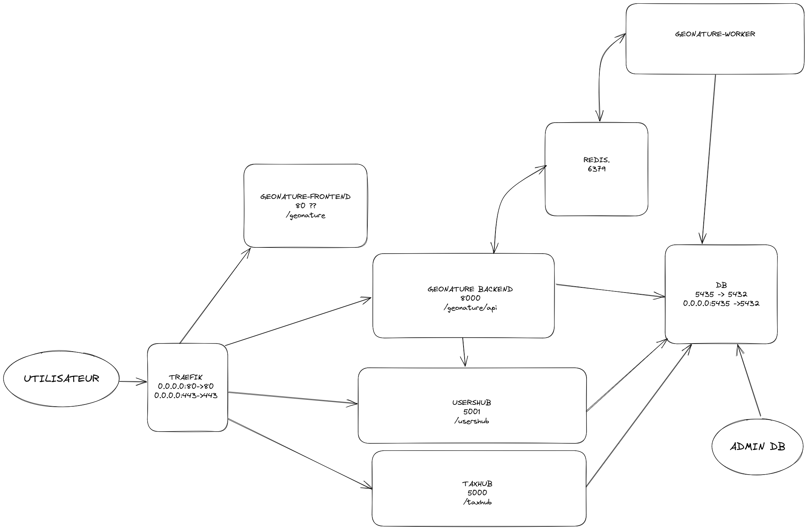

# GeoNature Docker services

Ce dépôt permet de déployer automatiquement et facilement **GeoNature** et son écosystème dans un environnement dockerisé et accessible en HTTPS.

## Principes et objectifs

**1. GeoNature clé en main**

Un fichier de configuration et une commande suffisent à déployer et mettre à jour facilement un environnement GeoNature dockerisé, fonctionnel et complet (GeoNature et ses principaux modules)

**2. Modulaire et adaptable**

Doit permettre à chacun d'adapter le projet pour ses besoins spécifiques et son infrastructure.

**3. Limiter la complexité globale**

Le projet ne doit pas inclure de fonctionnalités trop spécifiques à un contexte. L'ajout de fonctionnalités (paramètres, makefile...) ne doit pas se substituer à une maitrise de Docker, GeoNature ou d'administration système.

## Démarrage rapide

1. **Installation de Docker** ([Voir la documentation](https://docs.docker.com/engine/install/))
2. **Ajout de votre utilisateur courant au groupe `docker`**
   - Ajouter votre utilisateur courant dans le groupe docker : `sudo usermod -aG docker USER`
   - Réouvrir sa session Linux pour appliquer les changements
   - Plus d'infos sur la [documentation officielle](https://docs.docker.com/engine/install/linux-postinstall)

3. **Installation de `git`**
   - `sudo apt-get install git`

4. **Clonage du dépôt de GeoNature-Docker-services** : `git clone https://github.com/PnX-SI/GeoNature-Docker-services` ou extraire une [archive](https://github.com/PnX-SI/GeoNature-Docker-services/releases)

5. **Déplacement dans le répertoire du dépôt** : `cd GeoNature-Docker-services`

6. **Création du fichier `.env` à partir du fichier d’exemple** : `cp .env.sample .env`.

7. **Changement des variables de configurations obligatoires dans le fichier `.env`**. Les variables obligatoires sont les suivantes :
   - `GEONATURE_DB_LOCAL_SRID` : Code des projections des géométries stockées dans GeoNature (par défaut 2154)
   - `POSTGRES_PASSWORD` : Mot de passe de la base de données [PostgreSQL](https://www.postgresql.org/)
   - `UID` et `GID` : Indique l'utilisateur utilisé par les conteneurs. Utiliser la commande `id -u` pour récupérer la valeur pour `UID` et `id -g` pour récupérer la valeur pour `GID`
   - `COMPOSE_FILE` : Indique les fichiers compose que vous souhaitez utiliser.
    - `docker-compose.postgres.yml` : À désactiver pour utiliser une base de données externe (voir section dédiée).
    - `docker-compose.traefik.yml` : À activer pour utiliser traefik et servir GeoNature et UsersHub derrière un même port. Dans ce cas, vous devez renseigner également `TRAEFIK_HTTP_PORT` (laisser vide pour utiliser le port 80, mais la variable doit être impérativement définie), `GEONATURE_BACKEND_PREFIX`, `GEONATURE_FRONTEND_PREFIX` et `USERSHUB_PREFIX`.
    - `docker-compose.traefik-https.yml` : À activer pour que traefik écoute également en HTTPS. Dans ce cas vous devez également renseigner `TRAEFIK_HTTPS_PORT` (laisser vide pour utiliser le port  443, mais la variable doit impérativement être définie). Vous devez également définir `ACME_EMAIL` pour que soit générer des certificats SSL valides par [Let's Encrypt](https://letsencrypt.org/fr/).
    - `docker-compose.dev.yml`: À activer pour le développement (voir section dédiée).

- Pour éviter les mise à jour inattendues, il est recommandé de décommenter les variables `GEONATURE_BACKEND_IMAGE`, `GEONATURE_FRONTEND_IMAGE` et `USERSHUB_IMAGE` et de remplacer `latest` par le numéro de version à utiliser.

  Vous pouvez à tout moment vérifier la configuration finale avec `docker compose config`.

1. **Initialisation des fichiers de configurations.** Lancer la commande `./init-config.sh` afin de créer les dossiers et les fichiers de configuration requis. Le script `init-config.sh` génère aléatoirement aussi les clés secrètes pour GeoNature et UsersHub respectivement dans les fichiers suivants :
   - `config/geonature/geonature_config.toml`
   - `config/usershub/config.py`

2. **Lancer la création des conteneurs Docker** : `docker compose up -d`

## Exécuter la commande `geonature`

Utilisez `docker compose exec -it geonature-backend /entrypoint.sh geonature --help`

Pour faciliter l’accès à la commande `geonature`, vous pouvez utiliser [`direnv`](https://direnv.net/). Une fois installé, lancez `direnv allow` dans le dossier GeoNature-Docker-services. Le dossier `bin` sera alors automatiquement ajouter à votre `PATH` lorsque vous rentrez dans le dossier, et vous pourrez alors exécuter la commande `geonature` directement.

## Les services

- `postgres` : la base de données
- `usershub` : la gestion des utilisateurs
- `geonature-backend` : l’API de GeoNature
- `geonature-frontend` : l’interface web de GeoNature
- `geonature-worker` : exécution de certaines tâches de GeoNature en arrière-plan (import, export, mail, etc...)
- `redis` : service de communication entre le worker et le backend
- `traefik` : serveur web redirigeant les requêtes vers le bon service

```
SERVICE              PORTS
geonature-backend    8000/tcp
geonature-frontend   80/tcp
geonature-worker     8000/tcp
postgres             0.0.0.0:5435->5432/tcp, :::5435->5432/tcp
redis                6379/tcp
traefik              0.0.0.0:80->80/tcp, 0.0.0.0:443->443/tcp, [::]:80->80/tcp, [::]:443->443/tcp
usershub             5001/tcp
```


